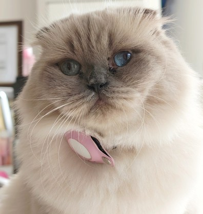

# Krema Masaüstü

Krema, Pativukat’ın mavi gözlü, kıvrık kulaklı kedisi. Windows masaüstünde patisini fareyle oynatır, yazarken küçük klavyesine dokunur. Başını okşayınca gözlerini kısar ve elinize doğru eğilir. Krema miyavlayamıyor. Sevildiğinde çıkardığı sesi en iyi “ıh ıhh” diye tarif edebiliyoruz.

[Windows 11 için indir (ZIP, 64 bit)](https://github.com/ahmetcihatgokce/krema-masaustu/raw/refs/heads/main/indir/Krema-Masaustu-Windows.zip) · [acgokce](https://acgokce.vercel.app/windows) · [Pativukat Uygulamalar](https://pativukat.com/uygulama#krema-masaustu)



Bu fotoğraftaki kedi gerçek Krema. Masaüstündeki dört hareketli poz, sahibinin çektiği Krema fotoğrafları referans alınarak dijital olarak hazırlandı. **Okşama, tıslama ve uyku seslerinin üçü de gerçek Krema’nın kendi kayıtları.** Okşamada sahibinin gönderdiği 7,7 saniyelik kayıt baştan sona çalar. Uyku kaydının sesi duyulabilmesi için yükseltildi.

## Krema ile tanışın

ZIP dosyasını bir klasöre çıkarıp **Krema.exe** dosyasını açın. Krema ekranın sağ alt köşesine yerleşir. Çalıştırmak için kurulum veya hesap gerekmez.

| Ne yaparsanız | Krema’nın tepkisi |
| --- | --- |
| İmleci tıklamadan başının üzerinde ileri geri gezdirin | Başını elinize doğru uzatır, gözlerini kısar ve aralıklarla kendi okşama sesini çıkarır. |
| Yanına ya da arkasına dokunun | Tıslayıp geri çekilir. İmleci orada bekletince ses tekrar tekrar başlamaz. |
| Farenizi hareket ettirin veya yazı yazın | Bakışı ve patileri hareket eder. Klavyedeki tuşa patisiyle karşılık verir. |
| Fare ve klavyeye 25 saniye dokunmayın | Kıvrılıp uyur. Uyandığında uyku sesi kesilir. |
| Sol tuşla tutup sürükleyin | Krema’yı masaüstünde istediğiniz yere taşırsınız. |
| Krema’ya veya bildirim alanındaki simgesine sağ tıklayın | İmlecin peşinden yürümeyi açabilir, sesi kapatabilir, Krema’yı gizleyebilir veya çıkabilirsiniz. |

Uygulama çevrimdışı çalışır. Fare ve klavye hareketlerini patileri canlandırmak için o anda kullanır. Girilen tuşları kaydetmez veya göndermez.

## Kendi kedinle yap

1. GitHub’da **Fork** ile kendi kopyanı oluştur veya **Code → Download ZIP** ile kaynakları al. Aşağıdaki işlemleri kaynak kodunun bulunduğu klasörde yap.
2. Kedinin yüzünü, gövdesini ve kuyruğunu gösteren birkaç fotoğraf seç. Fonunu kaldırıp aşağıdaki dört pozu şeffaf RGBA PNG olarak hazırla. Her şablonu açıp yeni kedinin gözlerini, patilerini ve kuyruğunu benzer yerlere hizala. Yürüyüşte baş sağa bakmalı. Böylece mevcut hareketler ve dokunma alanları kedinin üzerinde kalır.
3. Kedinin üç sesini ayrı dosyalar hâlinde kaydet. Aşağıdaki adları kullanarak sesleri ve görselleri `media/` klasöründe değiştir. Bir kaydı videodan almak için şu örneği kullanabilirsin.

   ```sh
   ffmpeg -i oksama-videosu.mp4 -map 0:a:0 -vn -c:a pcm_s16le -ar 44100 -ac 1 media/oksama.wav
   ```

| Dosya | İçerik | Biçim |
| --- | --- | --- |
| `media/awake.png` | Otururken, yüz ve ön patiler görünür | 428 × 454 px, RGBA |
| `media/hiss.png` | Aynı açıdan tıslama pozu | 428 × 454 px, RGBA |
| `media/sleep.png` | Kıvrılmış uyku pozu, baş sağda | 394 × 252 px, RGBA |
| `media/walk.png` | Yandan yürüyüş, baş sağda | 486 × 326 px, RGBA |
| `media/oksama.wav` | Başını okşarken çıkardığı ses | 16 bit PCM WAV, mono veya stereo |
| `media/tislama.wav` | Tıslama veya kendi kedine uygun bir tepki | 16 bit PCM WAV, mono veya stereo |
| `media/uyku.wav` | Başına ve sonuna sessiz pay bırakılmış bir uyku kaydı | 16 bit PCM WAV, mono veya stereo |

Klavye ve fare resimleri aynı klasördedir. Kedinin başı veya kuyruğu şablondan farklı bir yerde duruyorsa, `src/pet.c` içindeki `fur_region` fonksiyonunda dokunma bölgelerini ayarla. Bu fonksiyondaki `u` yatay, `v` dikey konumdur. İkisi de 0–1 arasındadır ve görselin sol üst köşesinden başlar. Aynı dosyadaki `pet_touch` sesin tekrar aralığını, `pet_step` uykuya geçişi yönetir.

### Windows’ta derle ve dene

[MSYS2](https://www.msys2.org/) kurup **MSYS2 MINGW64** terminalini aç. Aşağıdaki komutları kaynak klasöründe çalıştır.

```sh
pacman -S --needed make mingw-w64-x86_64-gcc mingw-w64-x86_64-python mingw-w64-x86_64-python-pillow
make PREFIX=
make PREFIX= test
./Krema.exe
```

Önceki sürüm açıksa bildirim alanından **Çıkış** seç. Yeni EXE’yi açtıktan sonra başını okşayarak, yanına dokunarak ve 25 saniye hareketsiz bekleyerek üç kaydın doğru yerde çaldığını kontrol et. Fotoğrafı veya sesi tekrar değiştirirsen aynı klasörde yeniden `make PREFIX=` çalıştır. Görselleri ve sesleri EXE içine paketlediği için kendi sürümünü başka bir Windows bilgisayarına tek dosyayla taşıyabilirsin.
